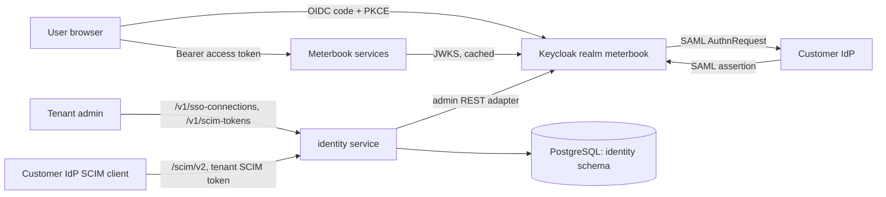

# Design Doc: Identity — login, enterprise SSO and SCIM provisioning

- **Author(s):** Mohit Raj
- **Status:** Approved
- **Last updated:** 2026-10-23
- **Tasks:** MB-T07 (this doc), MB-T08 (tenancy), MB-T09 (API keys), MB-T11 (RBAC, audit)
- **Reviewers:** —

## 1. Overview

Every Meterbook request needs a verified user and exactly one tenant. Keycloak issues the tokens and brokers each
customer's own identity provider; the identity service manages tenants, SSO connections and SCIM provisioning, and
tells other services who is calling (ADR-0007).

## 2. Goals and non-goals

**Goals:**
- G1: A user of a tenant with a SAML SSO connection signs in through their company IdP, and the resulting token
  names that tenant (SSO end-to-end test, TC-PLT-001).
- G2: A user deactivated over SCIM cannot sign in again, and their sessions end before the SCIM call returns.
- G3: No request can read or change another tenant's connections, tokens, users or groups (isolation tests: 404).
- G4: `GET /v1/me` p99 ≤ 50 ms in-cluster (token validated locally against cached JWKS).

**Non-goals:**
- NG1: Projects, environments and row-level security (MB-T08).
- NG2: Fine-grained RBAC and the audit log (MB-T11); MB-T07 has two roles, `platform-admin` and `tenant-admin`.
- NG3: API keys for machine access (MB-T09).
- NG4: Proving domain ownership by DNS record (MB-T11). Until then only a platform admin can add a domain to a tenant.

## 3. Background

Nothing exists yet: this is the first service. Enterprise buyers of billing software require SSO and SCIM before
they sign; most self-serve users sign in with a password.

## 4. Requirements

### Functional
- FR1: Platform admin creates a tenant with a name, a slug, its email domains and its first admin.
- FR2: Tenant admin adds, lists and deletes SAML 2.0 SSO connections. The response tells them which SP entity ID and
  ACS URL to configure in their IdP.
- FR3: Login routes a user to their tenant's IdP by email domain. A SCIM-provisioned user is linked to their tenant's
  IdP by the identity service (Keycloak federated identity); anyone else is created as a member of the tenant on first
  login (just-in-time). A first login never links to an existing account by email (§9).
- FR4: Tenant admin issues and revokes SCIM tokens; a token is shown once.
- FR5: SCIM 2.0 Users (create, get, list with `filter=userName eq "…"`, replace, patch, delete) and Groups (create,
  get, list, patch members, delete), plus `ServiceProviderConfig`, `ResourceTypes` and `Schemas`.
- FR6: `GET /v1/me` returns the caller's user ID, tenant ID, email, name, roles and how they signed in.

### Non-functional
| Requirement | Target | How measured |
|---|---|---|
| Availability | 99.9% monthly for `/v1/me` and token validation | Prometheus SLO (M-PLT-01) |
| Latency (p99) | `/v1/me` ≤ 50 ms; login ≤ 300 ms excluding the customer IdP | k6 (LR-PLT-01) |
| Throughput | 500 logins/s; 5,000 `/v1/me` per second per replica | k6 |
| Deprovisioning | sessions ended before the SCIM response; access tokens live 5 min | SSO e2e test |
| Tenant isolation | every cross-tenant read returns 404 | isolation tests |

## 5. Capacity estimate

Launch target: 1,000 tenants × 50 users = 50,000 users. Peak logins at 09:00 across time zones: assume 20% of users
in one hour → 10,000/h ≈ 3 logins/s average, 30/s with a 10× burst — far under the 500/s test target. `/v1/me` is
called once per portal page load: 50,000 users × 200 loads/day ≈ 10M/day ≈ 115/s average, ~1,000/s peak; one
replica handles that (JWT validation is local). SCIM traffic is bursty but small: an initial sync of 5,000 users is
5,000 requests over a few minutes. Storage: a user row is ~0.5 KB → 25 MB for 50,000 users. Two replicas each of
Keycloak and identity cover launch with headroom.

## 6. High-level design

- **Keycloak** holds credentials, sessions, signing keys, organizations (one per tenant) and identity providers. Its
  realm is imported from `infra/keycloak/realm-meterbook.json`.
- **identity service** (Java, ADR-0008) is the only writer of tenants, SSO connections, SCIM tokens and SCIM
  resources. It talks to Keycloak through `KeycloakDirectory`, an interface with one HTTP implementation (Keycloak
  admin REST API, client-credentials auth) and an in-memory fake for unit tests.
- **Other services** validate tokens themselves and call identity only for data they cannot read from the token.

## 7. Detailed design

### 7.1 API

`contracts/openapi/identity-v1.yaml`: `/v1/me`, `/v1/tenants`, `/v1/sso-connections`, `/v1/scim-tokens`, and the
SCIM 2.0 surface under `/scim/v2`. SCIM uses its own media type (`application/scim+json`) and error shape
(RFC 7644 §3.12), as SCIM clients expect; everything else follows `api-standards.md`.

### 7.2 Data model and storage

Schema `identity` in the shared PostgreSQL instance, owned by the identity service (Flyway).

| Table | Key columns | Notes |
|---|---|---|
| `tenants` | `id` (= Keycloak organization ID), `slug` unique, `name` | |
| `tenant_domains` | `domain` primary key, `tenant_id` | one tenant per domain, enforced by the key |
| `sso_connections` | `id`, `tenant_id`, `keycloak_alias` unique, `protocol`, `idp_entity_id`, `sso_url` | certificate kept in Keycloak only |
| `scim_tokens` | `id`, `tenant_id`, `token_hash` unique, `prefix`, `revoked_at`, `last_used_at` | token = `mbscim_` + 32 random bytes, base62 |
| `scim_users` | `id`, `tenant_id`, `user_name`, `external_id`, `keycloak_user_id`, `active`, `version` | unique `(tenant_id, lower(user_name))` |
| `scim_groups`, `scim_group_members` | `id`, `tenant_id`, `display_name`; `(group_id, user_id)` | |
| `idempotency_keys` | `(tenant_id, key)` | stored response for 24 h |

### 7.3 Consistency, ordering and idempotency

- **Two stores, one request.** A SCIM or connection change runs in one database transaction; the Keycloak call is
  made inside it, after the row is written and before commit. If Keycloak fails or times out (2 s, two retries with
  jitter for idempotent calls), the transaction rolls back and the client gets 503 with `Retry-After`; SCIM clients
  retry. If the commit fails after Keycloak succeeded, a compensating Keycloak call undoes the change. A nightly
  reconciler comparing both stores is follow-up work (MB-T16).
- **Idempotency.** `POST /v1/tenants`, `/v1/sso-connections` and `/v1/scim-tokens` require `Idempotency-Key`
  (api-standards: same key and body → stored response; different body → 422; concurrent → 409). SCIM has no such
  header; its creates are naturally idempotent through the `userName` uniqueness conflict (409 `uniqueness`).
- **Optimistic concurrency.** SCIM resources carry `meta.version` (ETag); `If-Match` mismatches return 412.

### 7.4 Multi-tenancy and isolation

The tenant comes only from the credential: the `organization` claim of a Keycloak token, or the tenant bound to a
SCIM token. Every repository method takes a `TenantId` and every query filters on it; a resource of another tenant
is 404. Isolation tests cover each endpoint. Row-level security as a second line arrives with MB-T08.

### 7.5 Failure modes

| Failure | Detection | Impact | Mitigation |
|---|---|---|---|
| Keycloak down | readiness of identity checks the JWKS cache age; Keycloak readiness probe | no new logins; existing tokens keep working until expiry | 2 replicas, PDB; JWKS cached 10 min |
| Keycloak slow during SCIM | client timeout 2 s | SCIM request 503 | retry with backoff; SCIM client retries |
| Identity DB down | readiness probe | SSO admin and SCIM unavailable; logins still work | RDS Multi-AZ in prod |
| Signing key rotated | JWT `kid` unknown | one JWKS refresh | resource server refetches JWKS on unknown `kid` |
| Customer IdP certificate expires | SAML signature failure in Keycloak logs | that tenant's SSO logins fail | admin replaces the connection; password login for admins stays possible |

## 8. Alternatives considered

Building our own authorization server, Zitadel, and hosted vendors — see ADR-0007.

## 9. Security and privacy

- **Spoofing:** tokens validated for signature, issuer, audience, expiry; SCIM tokens are 256-bit random, compared by
  SHA-256 hash; SAML assertions must be signed (`wantAssertionsSigned`) and are validated by Keycloak.
- **Tampering:** TLS everywhere; tenant never taken from request bodies.
- **Repudiation:** every admin and SCIM change is logged with tenant, actor and request ID (audit service: MB-T11).
- **Information disclosure:** cross-tenant access returns 404; logs never contain tokens, assertions or passwords.
- **Denial of service:** Keycloak brute-force detection; per-tenant rate limits (MB-T12).
- **Elevation of privilege:** a domain can map to only one tenant, and only a platform admin can add domains, so a
  tenant cannot claim another company's users through an IdP it controls. Each tenant controls its own IdP and could
  assert any email, so a first SSO sign-in **never links to an existing account by email** (that would hand a tenant
  any user of any other tenant); it can only create a new user. SCIM users are linked to their own tenant's IdP
  explicitly, and SCIM accepts only emails in the tenant's domains. The identity service account holds
  `manage-users`, which in Keycloak allows mapping any realm role; the adapter therefore grants only `tenant-admin`
  (enforced in code and tested). Restricting this inside Keycloak with fine-grained admin permissions is follow-up
  work (MB-T11).
- **Data:** emails and names are PII, stored only in Keycloak and `scim_users`; deleting a SCIM user deletes both.

## 10. Observability

OTLP traces for every request and Keycloak call; RED metrics per endpoint; JSON logs with `trace_id`, `tenant_id`,
`request_id`. Alerts: 5xx ratio on `/scim/v2` > 2% for 10 min; Keycloak call p99 > 1 s.

## 11. Testing and rollout plan

| Level | What |
|---|---|
| Unit | domain rules, SCIM filter and patch parsing, token hashing, error mapping |
| Integration (Testcontainers) | PostgreSQL migrations and repositories; Keycloak adapter against a real Keycloak |
| API | every endpoint: success, auth (401/403), validation (400/422), isolation (404), idempotency |
| Contract | responses validated against `identity-v1.yaml` |
| End-to-end (TC-PLT-001) | Playwright: SAML login through a test IdP realm, SCIM provisioning, deactivation blocks login |
| On EKS | identity and Keycloak deployed by ArgoCD; verification signs in and calls `/v1/me` |

Rollout: deployed to dev and staging by ArgoCD on merge; prod by promotion PR (ADR-0006). Rollback: promote the
previous commit; Flyway migrations are additive only.

## 12. Cost

Two Keycloak and two identity pods at 0.25 vCPU / 768 MiB and 0.25 vCPU / 512 MiB fit on the existing nodes (no new
nodes at launch); database storage is negligible. At 10× (500,000 users) Keycloak needs ~4 replicas and a larger
database instance: roughly +$150/month.

## 13. Open questions

- Q1: OIDC customer IdPs (in addition to SAML) — same adapter, add when a customer asks.
- Q2: IdP-initiated SAML login — disabled by default (it weakens replay protection); revisit on demand.
